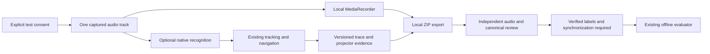

# Phase 5 — Capture, audio routing, and accuracy readiness

Date: 2026-11-06. Branch: `benchmark/end-to-end-accuracy`.
Base: local main `252c80cb0f28bb3c390efe68f8522fd761e745eb`.

**Authentic Kirtan accuracy remains unavailable.** This phase establishes a working
native audio-track path through the application, an opt-in audio/trace bundle,
and a local independent-review workflow. No actual Kirtan accuracy is inferred
from synthetic speech, matcher parity, recording success, or canonical text.

## Feasibility and actual evidence

The earlier fake-microphone path was insufficient. In Chrome 156.0.8078.80,
ordinary native `start()` returned `no-speech` for a locally synthesized original
English control phrase, both without and with parallel MediaRecorder capture.
Native `start(audioTrack)` produced actual speech results from that control.
The [Web Speech API](https://webaudio.github.io/web-speech-api/#dom-speechrecognition-start)
and [start documentation](https://developer.mozilla.org/en-US/docs/Web/API/SpeechRecognition/start)
describe the audio-track input. Support must be tested in the target browser.

The final application test used real native recognition, the actual
`useVoiceRecognition` hook, actual line matching and trace/projector instrumentation.
It supplied the **same track object** to MediaRecorder and native recognition and
observed exactly **one** JavaScript microphone acquisition. It captured:

| Evidence | Final controlled application run |
|---|---:|
| Native recognition result events | 7 |
| Matcher events | 5 |
| Page events | 2 |
| Projector acknowledgements | 2 |
| Trace events | 43 |
| Duration | 6,083.5 ms |
| Audio retained | 44,434 bytes |
| Capture requests / same-track identity | 1 / confirmed |

This is a **synthetic wiring/compatibility control**, with fixture APIs and no
independent performance targets. It is not end-to-end Kirtan recognition accuracy.
The native constructor wrapper observes calls/results and checks track identity;
it does not fabricate transcript results. The production hook forwards a track
only for explicit test capture. Normal mic starts retain the original no-argument
path, as do ordinary restarts. Test restarts retain their supplied track; an ended
test track never triggers an intentional fallback to the live microphone.
Online result timing and event counts vary between runs; the table records this
specific control run rather than claiming bitwise native-service reproducibility.

Separate sample-based probes checked file routing into `getUserMedia`. They compare
20 ms RMS windows every 2 ms, searching up to two seconds of offset. A correlation
of at least 0.95 over at least four seconds is a conservative routing check, not a
recognition score or synchronization proof for reference labels.

| Input | Source envelope correlation | Captured frames / rate | Result |
|---|---:|---|---|
| Local calibration waveform | 0.990928 | 240,640 / 48 kHz | Supplied waveform observed in browser capture |
| Public zOtIpxMT9hU mirror | 0.962430 | 240,640 / 48 kHz | Supplied authentic audio observed in browser capture, offline only |
| Spoken synthetic controls | 0.867–0.919 across probes | 240,640 / 48 kHz | Envelope identity gate inconclusive; direct-track speech results observed separately |

The 5.013-second browser sample windows are not scored Kirtan coverage. An
`audiostart` event alone is not accepted as evidence that the supplied file was
processed. Correlation is also insufficient to establish a correct Pangti.
No global Windows audio routing, drivers, physical mic, existing browser profile,
live service, or existing backend session was changed. Available Windows audio
devices were inspected read-only; an isolated native track avoids virtual-driver
installation or rerouting a live device.

## Datasets actually inspected and excluded

The [pinned source manifest](recognition-sources.json) records URLs, hashes,
licenses, attribution and limitations. Sanitized observations are in
[the Phase 5 JSON report](examples/recognition-phase5-summary.json).

| Material | Work performed | Accuracy readiness |
|---|---|---|
| Existing 191.716 s real trace | Validation and deterministic matcher replay, 209 exact calls | No associated original audio or independent labels; unscored |
| Four reviewed benchmark references | All 61 canonical occurrences revalidated; 1,407.5 s referenced target time | Reference time is not application scored time |
| zOtIpxMT9hU audio mirror | Local browser file-routing probe only | No online recognition transfer or accuracy scoring in this phase |
| Other three benchmark mirrors | Existing cached metadata/hash and reference checks | No associated application run; timebase unresolved |
| OCR dataset v2 | Public metadata endpoint returned 401 | No bypass, audio download, or scoring |
| SGPC-clean v4 candidate | Public metadata returned 200; pinned revision inspected | No license declared in inspected card/file list, independent timing review unestablished; no audio downloaded |
| Local calibration waveform and original spoken control | Browser capture, native recognition and application wiring tests | Synthetic; excluded from real accuracy |

The four [reviewed benchmark references](https://github.com/karanbirsingh/live-gurbani-captioning-benchmark-v1/tree/5cfa23d583c8157e09beb07c911bc1009ae41b10)
have publisher-declared human review. Their
[annotation license](https://github.com/karanbirsingh/live-gurbani-captioning-benchmark-v1/blob/5cfa23d583c8157e09beb07c911bc1009ae41b10/LICENSE)
is CC BY 4.0. Attribution: **Live Captioning for Gurbani Kirtan benchmark v1 —
Karanbir Singh**. The linked audio mirrors have no established audio redistribution
or cloud-processing permission here. The annotation license is not applied to
the audio. No authentic mirror audio was sent to recognition services this phase.

Differences between reference and decoded mirror durations remain 2.273–4.557 s.
They may reflect trimming or a different edit; duration alone cannot locate an
offset or validate interior timestamps. No arbitrary rescaling or prediction-based
alignment was applied. Canonical BaniDB ID agreement confirms text identity, not
what was sung or when. Reference audio was not personally re-annotated.

The v4 candidate at
[the public dataset](https://huggingface.co/datasets/surindersinghssj/gurbani-kirtan-v4-sgpc-clean)
has revision `b8006e03912240176a318cc607c4af29ca568648`. Public availability and
provider quality tags are not substituted for permission or independent review.

## Real accuracy and statistical limits

There are **zero authentic application recordings scored against independently
verified, synchronized performance labels** and **zero scored target milliseconds**.
The following remain unavailable: Pangti and Shabad time-weighted accuracy, false
line jumps/hour, false automatic Shabad switches/hour, genuine transition latency,
recovery, correct hold/uncertain coverage, and total manual-intervention rate.
No confidence interval is meaningful with this denominator. Audio frames are
correlated samples, not independent labeled performances.

The old real trace still supports operational counts, not correctness. Its 209
exact matcher calls establish replay compatibility. Its projector acknowledgements
bound application delivery/commit timing, not physical display latency. The
synthetic evaluator fixture retains its known 60%/92% arithmetic results over
50,000 target ms; these are deliberately constructed outputs, never real accuracy.

## Opt-in capture workflow

Open a Shabad or Katha Ang viewer, expand **Voice debug**, then **Audio + trace
test capture**. Use a separate test session and stop any active live mic first.

1. Confirm permission to record everyone audible. The control starts disabled.
2. Optionally permit browser recognition. This is off by default and explicitly
   discloses provider processing. Leave it off for separate audio-only capture.
3. Select **Record test session**, perform/play the authorized material, optionally
   mark an independently identifiable audible/visible cue, then **Stop test capture**.
4. Select **Export capture bundle**. Retain the downloaded ZIP privately. The
   standalone JSON trace download also remains available. Export before discarding
   the retained test capture and starting another recording.

Calibration input has a separate checkbox so constructed controls remain excluded
from real accuracy reports. Test capture refuses to overwrite an active standalone
trace. Starting during an active viewer mic is disabled. No capture or playback
starts automatically, and no file-input injection is installed in the live app.

The ZIP contains `manifest.json`, `trace.json`, and, when available, `audio.webm`,
`audio.mp4` or `audio.ogg`. It uses stored binary entries rather than base64 and
requires no archive dependency. Contents include incremental recognition times,
matcher proposals, tracking/navigation/page decisions, projector publications/acks,
trace sync markers, recording lifecycle and chunk timecodes, exact hashes, browser,
build revision/dirty flag, consent, bounds and partial-capture status. Device IDs,
group IDs and microphone labels are omitted.



[MediaRecorder events](https://developer.mozilla.org/en-US/docs/Web/API/MediaRecorder)
and chunk timecodes do not establish the first sample's exact trace timestamp.
The manifest therefore declares `provisional-lifecycle-only`, retains request/start/
stop observations and markers, and leaves timing uncertainty unknown. A clicked
marker must accompany an independently identifiable recording cue to establish
alignment. No audible tone is inserted and no exact synchronization is fabricated.

This capture does not upload audio. Separately enabled
[browser speech recognition may use an online provider](https://developer.mozilla.org/en-US/docs/Web/API/SpeechRecognition).
Only the original synthetic spoken control was authorized for new online tests.
Do not use private or unpermissioned audio for such probes. The local review page
has a network-denying content security policy and makes no upload requests.

## Bounds, interruptions, and compatibility

Audio retention is bounded at 16 MiB and ten minutes, with one-second recorder
chunks. Trace bounds remain 120,000 events/32 MiB/12 hours. The ZIP reader limits
input to 64 MiB, three fixed filenames and stored entries; it verifies header
consistency, CRCs, SHA-256, session identity and synthetic classification. It rejects
compression, traversal, duplicate entries and corrupt/mismatched payloads.

Permission denial/timeout, late permission completion, no supported format, missing
start/stop events, recorder error, ended track, trace interruption/replacement,
duration/byte limits and page departure retain exportable partial evidence when
the window survives. Only capture-owned tracks are released. A replacement trace
is not stopped. The capture stops when its viewer unmounts; returned exports
explicitly distinguish partial capture. This is bounded segmentation rather than
durable recording across page reloads or a complete browser crash.

An unload warning protects active capture, but closing/reloading can still lose
unexported memory. Private downloads have no automatic retention or deletion.
Codec internal buffering, snapshot/export copies and browser suspension are outside
the serialized-byte bound; **16 MiB is not a JavaScript heap ceiling**. An overflowing
chunk is dropped and the retained prefix is marked partial; a partial codec stream
may not be fully playable. Export/review each segment before continuing.

The shared-track online path is experimentally verified in desktop Chrome
156.0.8078.80 for short calibration runs. A conservative desktop Chromium 135+
gate follows the [documented track-parameter support](https://github.com/mdn/browser-compat-data/blob/main/api/SpeechRecognition.json);
older/mobile engines retain audio-only capture. This compatibility floor is not
proof of recognition processing. No physical microphone contention or
long-service reliability claim follows. It removes the deliberate second JS mic
request in this path; older browsers may not support native track input. Edge,
mobile browsers, physical devices and all codec variants were not exercised.
Audio-only capture remains available independently of recognition. No automatic
fallback to the live mic is implemented when a supplied test track ends.

## Independent annotation assistance

The review CLI validates/extracts a bundle, generates a local audio review page,
and imports canonical choices only from a separately supplied BaniDB response.
It never turns application predictions into answer labels. The four pinned external
references can supply repeated-occurrence candidates; license, attribution and
hashes accompany them. Candidates remain provisional even if their IDs validate.

```powershell
node tools/prepare-capture-review.mjs path/to/capture.zip --out .cache/review/new-session
```

For source-assisted review, add `--canonical canonical-shabad.json --source-url
https://api.banidb.com/v2/shabads/3712 --reference reviewed-reference.json`. The
reference must match a licensed pinned source in `docs/recognition-sources.json`.
Opening `index.html` supplies audio seeking, current-time boundary buttons,
canonical target choices, repeat candidates and ambiguous intervals. Unreviewed
targets and unconfirmed alignment cannot be exported as verified labels. The
provisional draft is clearly non-independent; the existing evaluator rejects it.
Verified exports require independent cue confirmation, ordered non-extrapolated
anchors, positive timing uncertainty and confirmation of each selected target.
Gaps remain unscored. The tool does not independently listen or authenticate a
reviewer's declaration; a valid-looking click is not itself scientific proof.

After actual independent review, the existing evaluator accepts the verified
trace-relative labels. No manually authored JSON is necessary:

```powershell
node tools/evaluate-recognition.mjs .cache/review/new-session/trace.json reviewed.labels.json --out .cache/reports/new-session --require-metrics
```

No independent annotation was fabricated or requested from the operator for this
phase. The assisted tool was exercised with a synthetic recording and external
provisional candidates, yielding **zero verified labels** and no accuracy score.
Review resumption/import, automatic audible cue detection and durable audio storage
are not implemented. Human/source verification of sung words remains essential.

## Verification executed

All commands were run in the assigned worktree; frontend/backend commands ran
from their own folders. No live service, microphone or BaniDB is needed for tests.

```powershell
# frontend/
npm.cmd test -- --reporter=dot
$env:TEST_RECORDING='1'
npm.cmd test -- --reporter=dot
Remove-Item Env:TEST_RECORDING
npm.cmd run build
# backend/
npm.cmd test
# repository root
node --expose-gc tools/recognition-overhead.mjs --stress
node tools/validate-recognition.mjs --discover --fetch-public --out .cache/phase5/reference-evaluation
node tools/probe-audio-routing.mjs --out .cache/phase5/routing-final
node tools/probe-audio-routing.mjs --audio .cache/real-validation/acquired/audio/zOtIpxMT9hU.wav --policy .cache/phase5/public-local-policy.json --out .cache/phase5/public-routing-local
node tools/probe-audio-routing.mjs --audio .cache/phase5/control-speech.wav --policy .cache/phase5/control-policy.json --online --with-recorder --mode track --out .cache/phase5/speech-track
node tools/smoke-recognition-browser.mjs --capture-audio .cache/phase5/routing-final/calibration.wav --out .cache/phase5/capture-release-verification
node tools/smoke-recognition-browser.mjs --capture-audio .cache/phase5/routing-final/calibration.wav --deny-capture --out .cache/phase5/denied-complete
node tools/smoke-recognition-browser.mjs --native-app-audio .cache/phase5/control-speech.wav --policy .cache/phase5/control-policy.json --out .cache/phase5/native-complete
node tools/smoke-recognition-browser.mjs --review .cache/phase5/review-release/index.html --out .cache/phase5/review-release-browser
git diff --check
```

Results: **177/177 frontend tests in 14 files**, recording off and on;
**64/64 backend tests**; **224-module production build passed**, with the existing
large-chunk warning. The 45 added regressions cover audio consent/disabled state,
hash/identity checks, late permission resolution, partial interruptions, start/stop
timeouts, final chunks, stale callback isolation and cancelled online-start safety,
full-capacity 16 MiB prefix export/discard, ordinary versus
test-track recognition and ended-track restart safety, ZIP corruption and review
CLI gates. Existing replay/legacy/malformed annotations, V1/V2/V3/V5/V13, Kirtan,
Katha, manual correction and projector regressions remain passing.

Browser results: seven fixture capture/workflow checks passed; seven simulated
permission-denial/workflow checks passed; native application shared-track test
passed; three local review/audio/draft-gate checks passed. No page JavaScript errors
were present in the final runs. Screenshots were visually inspected. The smoke
retains Phase 4's isolated Chrome/service-worker-blocking setup; service-worker,
real phone pairing and physical display behavior remain outside its coverage.
Browser checks exposed and fixed browser timer receiver binding and rapid-denial
trace-export refresh defects during development.

The standalone probe returns exit 2 if its strict capture identity or requested
speech-result gate is unavailable. Thus the isolated spoken track probe reported
native results but still failed its separate envelope gate; it is not relabeled
as a fully passed identity check. The final application test independently proves
track-object identity and actual native events. The evaluator also rejected the
exported provisional draft with exit 2. Expected gate rejections are distinct from
the passing regression suite. No remaining automated regression failure is known.

The local Node v24.17.0 recorder probe measured approximately 0.021 µs/call disabled
and 3.918 µs enabled across 10,000 calls; disabled export/events were zero. The
130,000-attempt stress run retained 120,000 events, stopped with `event-limit`,
exported 10,421,237 bytes and observed a 53,251,096-byte heap delta, with zero
inactive growth/payload calls. These are noisy Node serialization measurements,
not live browser/audio accuracy or latency. The added capture UI/code is lazy with
the reader debug area; it adds no device access or audio serialization while idle.
There is no new runtime dependency. Real-device CPU, battery and heap profiling
remain necessary before relying on long combined recordings.

Probe policies bind an exact audio SHA-256, provenance, synthetic classification
and explicit `onlineRecognitionAuthorized: true` before any new online transfer.
The application native diagnostic accepts only authorized synthetic controls.
The spoken control was created locally with Windows speech synthesis from an
original calibration phrase; no new service or private recording was used to
prepare it. Cache tooling remains the existing ignored Playwright installation.
Policies, audio and profiles are local test artifacts, not repository assets.

The executed control-preparation recipe below reproduced the original WAV hash
`a08b23c639575b634c7013f52d4e27c51a1aba815acecf43f523665c642440d5` on this machine.
Other installed system voices may produce different bytes; the policy always
binds the newly created file. Use a new directory rather than overwriting evidence.

```powershell
$calibrationDirectory = Join-Path (Get-Location) '.cache/phase5/calibration-repro'
New-Item -ItemType Directory -Path $calibrationDirectory -ErrorAction Stop | Out-Null
Add-Type -AssemblyName System.Speech
$calibrationFile = Join-Path $calibrationDirectory 'control-speech.wav'
$calibrationSpeaker = New-Object System.Speech.Synthesis.SpeechSynthesizer
$calibrationSpeaker.SetOutputToWaveFile($calibrationFile)
$calibrationSpeaker.Speak('This is a controlled audio routing test. One two three four five. The recording contains no private conversation. Please recognize these spoken words. One two three four five.')
$calibrationSpeaker.Dispose()
$calibrationHash = (Get-FileHash -LiteralPath $calibrationFile -Algorithm SHA256).Hash.ToLowerInvariant()
@{sha256=$calibrationHash;onlineRecognitionAuthorized=$true;synthetic=$true;provenance='Original locally synthesized calibration phrase; authorized online diagnostic only'} | ConvertTo-Json | Set-Content -LiteralPath (Join-Path $calibrationDirectory 'control-policy.json') -Encoding utf8
```

## Changes and next recommendation

New: `CapturePanel.jsx`, `synchronizedCapture.js`, `captureBundle.js`,
`synchronizedCapture.test.js`, `captureReview.test.js`, `tools/prepare-capture-review.mjs`,
`tools/probe-audio-routing.mjs`, `tools/lib/capture-review.mjs`,
`tools/lib/audio-routing.mjs`, `tools/templates/capture-review.html`, this report
and the numeric JSON summary. Updated: `VoiceDebugPanel.jsx`/CSS, the optional
track branch in `useVoiceRecognition.js`, the read-only session ID accessor,
recognition instrumentation tests, Vite build identity, browser smoke tooling,
source manifest and benchmark guide link.

Matching/scoring algorithms, thresholds, hold/switch policy, Kirtan/Katha tracking
hooks, page navigation, AppContext, backend/security/remote code, dependencies,
lockfiles and semantic artifacts are unchanged. The original worktree was not
edited. Because Phase 4 was integrated as a separate reviewed commit, the clean
new branch was created directly from local main; no history was forced or reset.

The next recognition improvement should be evidence-driven: use the verified
same-track capture path with a permissioned representative Kirtan corpus and
independently verified cue/word alignment. Then measure repeats, Rahao, genuine
Shabad transitions, gaps, Katha and manual recovery before changing thresholds.
No policy tuning or real-world accuracy improvement is justified by these controls.
Local commit identifiers are supplied with delivery; nothing is pushed or merged.
