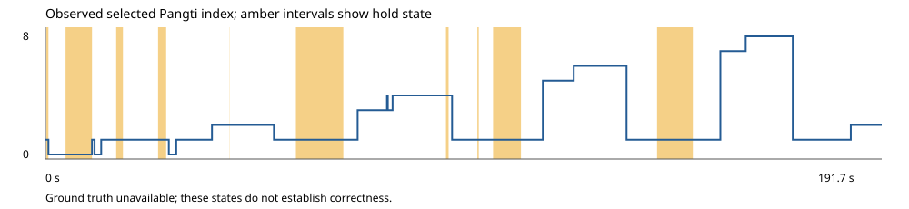

# Recognition real-world validation — Phase 4

Validation date: 2026-11-06. Base revision: `ea9b895980b332064b1f60ba96be19d495e253df`.
Worktree: `gurmatsaanj-tests`; branch: `benchmark/real-world-validation`.

**No real-world recognition accuracy score is supportable from the available evidence.**
One real 191.716-second application trace was inspected and replayed. Four public
recordings and their external references were acquired and checked. Zero recordings
had both a usable application capture and synchronized independent labels.
The implementation automates acquisition, canonical validation, evidence gates,
offline scoring when supported, and JSON/Markdown diagnostics without changing
recognition behavior. No raw private trace, audio, or third-party lyrics are included.

## Sources, annotation provenance, and readiness

The local trace has 1,008 v2 events, a complete capture flag, and SHA-256
`43357e7cfdd3e4ed2a42ce97f053db87c88a3bad4683aadd61143801355ba44f`.
Its original audio was not found in the scoped project/Downloads investigation.
The earlier annotation template explicitly declared `independent: false` and
contained only an ambiguous interval. Recognized words and selected Pangtis cannot
replace that missing reference. The trace contains Shabad `40027`; none of the
public references below establishes what was performed in this local session.
The recorded application's exact revision is unknown; current-checkout parity
does not establish the recorded build's identity.

The [Live Captioning for Gurbani Kirtan benchmark v1](https://github.com/karanbirsingh/live-gurbani-captioning-benchmark-v1/tree/5cfa23d583c8157e09beb07c911bc1009ae41b10)
provides publisher-declared hand-reviewed references. Its
[license](https://github.com/karanbirsingh/live-gurbani-captioning-benchmark-v1/blob/5cfa23d583c8157e09beb07c911bc1009ae41b10/LICENSE)
licenses ground-truth annotations under CC BY 4.0. Attribution: **Live Captioning
for Gurbani Kirtan benchmark v1 — Karanbir Singh**. Only four base recordings count
as distinct sources; cold-offset variants are not additional independent recordings.
External review is distinguished from personal audio re-annotation, which was not
possible with the available tools.

The source manifest pins reference commit `5cfa23d583c8157e09beb07c911bc1009ae41b10`,
audio-mirror commit `f11a12584fd24a49b2d6391b014394d7e413f569`, URLs and SHA-256
checksums. The publisher links those mirrors for benchmark playback. No explicit
audio redistribution license was located; the annotation license is not treated
as an audio license. Audio remains in ignored local cache only.

| Recording ID | Shabad | Occurrences | Reference duration (s) | Decoded audio (s) | Difference (s) | Referenced target time (s) |
|---|---:|---:|---:|---:|---:|---:|
| IZOsmkdmmcg | 4377 | 15 | 460.900 | 458.025250 | -2.874750 | 405.8 |
| kZhIA8P6xWI | 1821 | 17 | 308.300 | 306.027375 | -2.272625 | 233.2 |
| kchMJPK9Axs | 1341 | 18 | 654.600 | 650.042625 | -4.557375 | 532.9 |
| zOtIpxMT9hU | 3712 | 11 | 292.900 | 288.995563 | -3.904438 | 235.6 |
| Total | 4 | 61 | 1716.700 | | | 1407.5 |

All 61 Shabad/verse/index combinations passed separate reads of the canonical
BaniDB endpoints for [4377](https://api.banidb.com/v2/shabads/4377),
[1821](https://api.banidb.com/v2/shabads/1821),
[1341](https://api.banidb.com/v2/shabads/1341), and
[3712](https://api.banidb.com/v2/shabads/3712). This validates canonical identity,
not the audio timing or sung words. Reference intervals are clipped to each
source's declared evaluation window. Gaps are not invented as silence labels.

The duration discrepancies prevent automatic same-timebase assumptions; they do
not prove interior labels are wrong. No arbitrary offset, duration rescaling, or
prediction-based alignment was applied. Each public recording also lacks an
associated Gurmat Saanj trace. These references therefore supply **candidate
labels only**, not scored application performance. They do not establish coverage
of Katha, explanations, instrumental gaps, or multi-Shabad transitions.

The [OCR-derived dataset candidate](https://huggingface.co/datasets/surindersinghssj/gurbani-kirtan-dataset-v2)
returned HTTP 401 during access attempts. Its provider card describes slide OCR
and canonical fuzzy matching, which would still need independent performance
verification. No authentication bypass was attempted and no data from it was scored.

## Real operational measurements

These observations describe the available application trace, not correctness.
Sanitized numeric evidence and hashes are in
[the JSON summary](examples/recognition-validation-summary.json).

| Observation | Result and denominator |
|---|---|
| Duration / capture | 191,716.1 ms; complete; 1,008 events |
| Matcher-call parity | 209 calls replayed, zero mismatches |
| Tracked matcher flags | 205 of 209 calls; not accuracy |
| Far matcher proposals | 13 proposals more than one line from recorded input cursor; not committed false jumps |
| Selected page position changes | 20, excluding initial acquisition; correctness unknown |
| Recorded page-state time | 191,715.6 ms observed; 0.5 ms leading unknown |
| Following / held / uncertain | 153,217.3 / 36,387.8 / 2,110.5 ms over observed page-state time |
| Explicit manual events | 0 observed; does not prove there were no uninstrumented operator actions |
| Recognition lifecycle | 333 result observations; 3 ends and 3 restarts; no recorded error events |
| Recognition scripts | Gurmukhi in all 333 result observations; no Devanagari/Latin observations |
| Discovery | 32 requests, 25 results, 24 rejections, 7 expirations, 1 pending confirmation, zero recorded commitments |
| Projector publications | 49 publications, 49 received acks, 48 committed acks |
| Commit acknowledgement upper bounds | n=48; median 4.4 ms; nearest-rank p90 7.7 ms; p95 8.3 ms |

One publication lacks a commit acknowledgement; that alone does not establish a
lost frame. Ack bounds use the sender clock and include return delivery time.
They are not exact React commit times, paint times, physical display latency, or
projector Pangti accuracy. All 97 acks passed correlation/deduplication checks.
The legacy replay command's 22 "line moves" counts matcher proposals; the 20
page changes above are observed selected outputs. Neither is a false-jump count.



| Requested correctness measure | Result / missing evidence |
|---|---|
| Shabad and time-weighted Pangti accuracy | Unavailable; zero independently labeled, synchronized local target milliseconds |
| False line jumps and automatic Shabad switches | Unavailable; no correct-target reference or labeled-hour denominator |
| Transition latency and recovery | Unavailable; no independently timed actual transitions |
| Correct abstention / ambiguous coverage | Unavailable; local audio activities and ambiguity are unlabeled |
| Manual intervention frequency | Only the explicit event count is observable; total intervention coverage is unknown |
| Physical projector latency | Unavailable; no correlated paint or physical display observation |

ASR, retrieval, tracking, and navigation errors cannot be assigned reliably here.
No independent verbatim audio transcription exists for ASR comparison. Retrieval
events lack synchronized target labels; tracking proposals and committed outputs
lack their correct targets. The policy may have rejected incorrect alternatives
or missed genuine changes; these data cannot distinguish those outcomes.

## Five priority issues and ranked recommendations

These are verified evaluation gaps and operational findings, not five proven
recognition errors. No threshold or matching change is justified by this sample.

| Rank | Finding | Recommended next engineering step | Expected impact / change risk |
|---:|---|---|---|
| 1 | No usable local ground truth; all real correctness measures unavailable | Obtain an exact, permissioned audio/reference/application triplet with recorded build identity and independent sync cues; retain immutable hashes | Highest measurement value; low runtime risk |
| 2 | All four mirror durations differ; native file probe yielded no transcript | Resolve the source's actual edit/timebase and verify file-to-recognizer routing before capturing full runs; preserve external review provenance | High value; low app risk, capture environment uncertainty |
| 3 | 32 discovery requests, 7 expirations, 24 rejections in one short trace | Correlate request/result/expiry evidence with labeled genuine transitions and repetitions before considering policy changes | Potentially high switching value; high risk if thresholds change prematurely |
| 4 | 36.388 s held, 20 selected changes, no labeled explanation/gap or multi-Shabad coverage | Add independent repeated-Pangti/Rahao, silence, instrumental, Katha, manual-correction, and multi-Shabad recordings; compare held correctness and recovery | High safety value; low risk for data collection |
| 5 | Ack bounds do not measure physical display; replay is observational; full-cap heap exceeds serialized bytes | Add correlated display evidence and an actual-hook replay adapter as separate work; profile mobile recorder heap before changing limits | Medium value; medium implementation risk, keep diagnostics opt-in |

Existing fake-timer hook regressions cover the policy scenarios above, including
stale/cancelled responses. They do not replace independently labeled audio.
No switching-latency or recognition-accuracy improvement is claimed. Existing
confirmation delays, hold behavior, cooldowns and manual navigation remain intact.

## Implemented workflow and evidence gates

Before this phase, the evaluator accepted manually prepared independent labels
but did not acquire external references, verify canonical IDs, bind audio/reference
hashes, check decoded media metadata, or build a consolidated acquisition report.
The new tooling supplies these steps without adding runtime hooks or services.

From the assigned worktree, one command inventories trace exports, acquires pinned
references, validates canonical IDs, and writes reports plus a selected-state SVG:

```powershell
node tools/validate-recognition.mjs --discover --fetch-public --out .cache/real-validation/new-run
```

`--discover` is nonrecursive and scans only `kirtan-session-*.json` in Downloads
and this worktree's `.cache/recordings`. Use repeated `--trace path.json` for
explicit inputs instead. Omitting `--fetch-public` keeps the run offline.
Every new run should use a new output directory. Existing differing evidence is
never overwritten. Raw transcripts and local input paths are excluded from reports;
selected numeric indices and hashes remain diagnostic metadata.

Audio acquisition is separate and explicit; it is not needed for ordinary
regressions. This run used a locally installed decoder in ignored cache:

```powershell
node tools/validate-recognition.mjs --discover --fetch-public --fetch-audio --ffmpeg .cache/media-runtime/imageio_ffmpeg/binaries/ffmpeg-win-x86_64-v9.0.2.exe --out .cache/real-validation/final-evaluation
```

The decoder is not a project dependency. On another machine, supply an available
local decoder executable. HTTPS acquisition rejects redirects, unsuccessful HTTP
status, timeout, oversize responses, and pinned hash mismatches. No private data
is uploaded by this CLI. Tests mock external fetches.

For a supported exact recording, `--case verified-case.json --require-scored`
runs acquisition-independent scoring in the same command. A descriptor names
relative local `trace`, decoded PCM `media`, external `reference`, and
`canonical` files keyed by Shabad ID. Its `evidence` contains `recordingId`,
`traceSha256`, `mediaSha256`, `referenceSha256`, `independent: true`,
`status: "verified-external"`, `sourceUrl`, `license`, `timingUncertaintyMs`, and
at least two ordered `{mediaMs, traceMs}` synchronization anchors. The CLI exports
verified annotations, scored JSON/Markdown, and the evidence/canonical hashes.

Verified labels require canonical Shabad/verse/index agreement. Mismatches remain
provisional and become ambiguous/null targets. Media must have consistent PCM
WAV metadata and duration within 100 ms of the reference; this is a conservative
file-evidence gate, not a recognition threshold. Cropped or differently edited
sources need a supported exact reference/timebase before this path can score them.
Alignment never extrapolates beyond independent anchors. Source review and anchor
declarations remain auditable human/source claims, not truths proved by hashes.
The CLI does not fabricate anchors or ask the operator to label this run.

Scoring caveats for real cases (evaluator behavior, unchanged here): any
`timingUncertaintyMs` above zero reports every transition latency as
unavailable. Unlabeled time inside the evaluation windows, including gaps
between reference segments (289.2 of 1,696.7 s in these four sources), is
excluded from accuracy denominators, so abstention there is not measured.
A same-line repeat after a gap counts as a transition and can score 0 ms.
Results are therefore not comparable with the benchmark's own frame-level metric.

Exit codes: `0` valid report (accuracy may be unavailable), `1` matcher parity
mismatch, `2` invalid input or `--require-scored` with zero scored recordings.
Existing replay mismatch exit behavior is unchanged.

## Synthetic validation and regression results

The existing constructed 60-second fixture has 50 seconds of target time.
It still produces 30,000/50,000 ms = 60% Pangti accuracy, 46,000/50,000 ms = 92%
Shabad accuracy, one false line jump, one false automatic switch, three detected
transitions with 2-second median, one undetected transition, 2-second recovery,
and two interventions. These are evaluator arithmetic checks, not real recognition
measurements. New constructed cases test evidence rejection and successful CLI
scoring; their nominal 100% output is also unit arithmetic only.

The 24 new tests cover repeated reference occurrences, canonical mismatches,
bad IDs/overlapping intervals, evaluation-window clipping, missing evidence,
unsupported sync extrapolation, provisional exclusion, hashes, duration mismatch,
synthetic-promotion rejection, authoritative trace bytes, PCM validation, mocked
HTTP failures/byte limits, no overwrite, transcript omission, scoring export,
and required-score exit status. Existing legacy/v2, malformed trace/annotation,
V1/V2/V3/V5/V13, manual/hold/Katha and projector tests remain passing.

Commands executed (frontend/backend commands from their own folders):

```powershell
# frontend/
npm.cmd test -- --reporter=dot
$env:TEST_RECORDING = '1'
npm.cmd test -- --reporter=dot
Remove-Item Env:TEST_RECORDING
npm.cmd run build
# backend/
npm.cmd test
# repository root
node tools/replay-session.mjs '<path-to>\kirtan-session-<timestamp>.json'
node --expose-gc tools/recognition-overhead.mjs --stress
git diff --check
```

Final frontend result: **132/132 tests across 12 files**, recording off and on.
Backend: **64/64 tests**. Build: **221 modules; passed**, with the existing large
chunk warning. Real trace replay: **209 exact matcher calls**. The full suite
includes replay process failures, legacy compatibility, malformed inputs and
recording-disabled lazy-payload/serialization checks. No live mic/BaniDB is
required for automated regressions. `git diff --check` passed.

One Node v24.17.0 resource probe measured 10,000 calls at approximately 0.034 µs
disabled and 3.966 µs enabled; disabled export/events were zero. The event-limit
probe attempted 130,000 events, retained 120,000, marked the prefix incomplete
with `event-limit`, exported 10,389,596 bytes, and observed a 53,270,120-byte heap
delta including snapshot allocations. Another 10,000 inactive calls produced
zero growth and zero payload evaluations. This is a single-process synthetic
allocation/CPU check with GC noise, not a browser memory ceiling or live latency
measurement. The 32 MiB serialized budget has never been a heap guarantee.

## Browser verification and remaining limits

The first in-app browser attempt failed because its access host was unavailable.
The safe fallback used isolated, owned headless Chrome profiles with loopback
fixture APIs and mocked recognition. Existing windows, physical microphones,
live services, backend sessions and user profiles were not used.

```powershell
npm.cmd install --prefix .cache/browser-runtime --no-save --package-lock=false --ignore-scripts --no-audit --no-fund playwright-core@1.61.1
node tools/smoke-recognition-browser.mjs --out .cache/real-validation/browser-verified
node tools/smoke-recognition-browser.mjs --audio .cache/real-validation/audio/zOtIpxMT9hU-20s-probe.wav --out .cache/real-validation/native-verified
```

The production-build fixture smoke passed five checks: disabled projector message
shape, manual correction/cross-tab sync, valid trace export with actual React
commit acks, blank projector, and Katha mic workflow. No page JavaScript errors
were observed; the screenshot was visually inspected. This is desktop fixture
coverage, not a physical projector or real phone pairing/Sangat View exercise.
Backend tests cover pairing/revocation; no security code was changed here.
The smoke blocks the app's service worker. With an active worker, Playwright
1.61.1 failed the worker-handled `/projector` navigation (`net::ERR_FAILED`)
while plain Chrome rendered it, so earlier runs depended on install timing.
Service-worker behavior is therefore outside this smoke's coverage.

Native `pa-IN` recognition was separately probed with Chrome's fake file-device
input using the public zOt recording and a 20-second crop starting at source
20 seconds. Both emitted `audiostart`, then `no-speech`, with zero results.
The crop is SHA-256 `07c2404261a33d5e67a0cb8db26d7afc846be11ccffaa8ec53924ee5273d9e91`.
The final native probe reports **blocked**, exit `2`; this is not an accuracy
test or proof that the sung phrase is unrecognizable. Input routing, content and
speech-service behavior are unresolved confounders. Only public audio was used.
Chrome's recognizer streams the probe audio to its online speech service, so
never pass private or unpermissioned recordings to `--audio`.

Full counterfactual hook/network CLI replay, original-audio recovery, personally
verified audio annotations, real transition/ASR accuracy, physical display timing,
mobile memory profiling and real-device remote/follow smoke checks remain
incomplete. The source corpus is small and does not justify deployment or tuning
claims. The next work should resolve rank 1–2 evidence/capture gaps before changing
the recognition policy.

## Modified files and review boundary

- `tools/validate-recognition.mjs`: acquisition, case evaluation and reports.
- `tools/lib/recognition-validation.mjs`: canonical/media/evidence validation and diagnostics.
- `tools/smoke-recognition-browser.mjs`: isolated fixture smoke and native availability probe.
- `tools/recognition-overhead.mjs`: optional bounded-memory/event-limit stress probe.
- `frontend/test/recognitionValidation.test.js`: 24 deterministic offline regressions.
- `docs/recognition-sources.json`: pinned source URLs, rights/provenance and checksums.
- `docs/recognition-real-world-validation.md`: this consolidated report/workflow.
- `docs/examples/recognition-validation-summary.json`: sanitized numeric evidence.
- `docs/examples/recognition-validation-timeline.svg`: observed local state visualization.
- `docs/recognition-benchmark.md`: link to the automated workflow.

Runtime application code, algorithms, thresholds, hooks, `AppContext.jsx`, backend,
remote/security, dependencies/lockfiles and generated semantic artifacts are
unchanged relative to the base. The assigned clean branch was fast-forwarded
from `b059f0f` to local main before creating this feature branch. Other worktrees
were not edited. Browser/media tools and raw evidence stay in ignored cache.

Suggested conventional commit: `feat(benchmark): automate evidence-gated recognition validation`.
The local commit identifier is supplied with the delivery; no push or merge is
performed. This report is included in that commit, so it does not embed its own hash.
